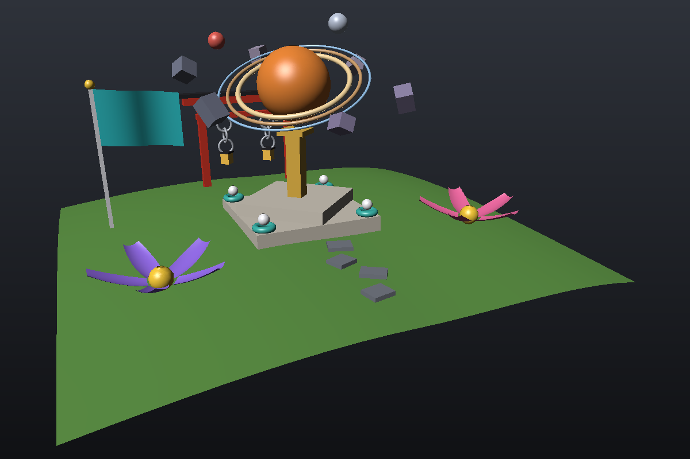
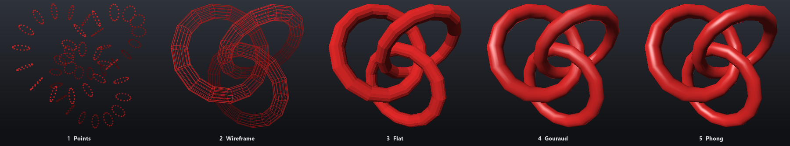

# Graph3D



A small 3D viewer with its own software renderer. It reads scenes from `.dat` text files
and draws them as points, wireframe, or with flat, Gouraud or Phong shading. Optionally the
graphics card can draw instead, through Direct3D 11 or OpenGL.

Requires the .NET 10 SDK on Windows. The first build downloads the Vortice (Direct3D) and OpenTK
(OpenGL) packages from NuGet.

```
dotnet run -c Release                     # opens TOR.DAT
dotnet run -c Release -- samples\patches.dat
```

## Shading modes



| Key | Mode      | What happens |
|-----|-----------|--------------|
| 1   | Points    | Vertices only. |
| 2   | Wireframe | All edges, dimmer when further away. |
| 3   | Flat      | One colour per triangle, from its face normal. |
| 4   | Gouraud   | Lighting computed at the three vertices; the colours are interpolated across the triangle. |
| 5   | Phong     | Vertex normals are interpolated across the triangle and lighting is computed for every pixel. |

Filled modes use a z-buffer and perspective-correct interpolation. Boxes are always shaded with
face normals, so their edges stay sharp.

## Renderers

Pick one from the **Renderer** menu in the toolbar; the choice is remembered
(`%LOCALAPPDATA%\Graph3D\settings.json`).

| Renderer | Who does what |
|----------|---------------|
| Software (CPU) | Everything is our own code: projection, triangle filling, z-buffer, lighting. The default, and the point of the project. |
| Direct3D 11 | The graphics card fills triangles and keeps the depth buffer. Projection and lighting run in our own HLSL shaders, translated from the software renderer. The menu lists every graphics card, so on a laptop you can choose the integrated or the dedicated one. |
| OpenGL 3.3 | The same as Direct3D, with GLSL shaders. OpenGL cannot choose the graphics card: Windows and the driver decide. To force the dedicated card, set Graph3D to "High performance" in Windows **Settings → System → Display → Graphics**, or in the NVIDIA/AMD control panel. |

All three produce the same picture; the GPU renderers add 4× multisampling, so edges are smoother.
They draw off-screen and copy the result back, so saving an image works the same way everywhere.
If a graphics driver fails, Graph3D switches back to the software renderer.

## Controls

Left drag: rotate · Right/middle drag: pan · Wheel: zoom · Double-click or **R**: reset view  
Arrow keys: rotate · **W A S D**: pan · **F/G** or **+/−**: zoom · **Ctrl+O** open · **Ctrl+S** save PNG · **F1** help.
You can also drop a `.dat` file onto the window.

## Scene file format (`.dat`)

Whitespace-separated tokens (line breaks don't matter), keywords are case-insensitive,
numbers use a decimal point. `#` starts a comment. Angles are in **radians**, applied around Z, then Y, then X.

```
kamera  xk yk zk angle                       # extra pan x/y, (distance – unused, the view is auto-framed), vertical FOV
kvader  x y z  dx dy dz  xangle yangle zangle
toroid  x y z  rin rout  xdetail ydetail  xangle yangle zangle
meshbs  x y z  xangle yangle zangle  + 5×5 control points "x y z"   # bicubic B-spline surface
meshbe  x y z  xangle yangle zangle  + 7×7 control points "x y z"   # 2×2 bicubic Bézier patches
farba   r g b                                                       # colour (0–255) of all following objects
koniec                                                              # optional end marker
```

- `farba` (also `color` / `colour`) applies to every object after it. Objects before the first `farba`
  use the default colour, which you can change with the **Colour…** button.
- +Y points **down** on screen (as in the original program), so "up" in a scene is negative Y.
- A `toroid` with outer radius `0` is a sphere.

### Samples

| File | Contents |
|------|----------|
| `TOR.DAT` | The original three interlocked tori. |
| `samples/celestial_garden.dat` | Showcase of everything: a ringed planet over a pedestal, a gate with lantern chains, a waving Bézier flag, B-spline flowers, a Bézier landscape. |
| `samples/patches.dat` | One of each object type, uncoloured. |
| `samples/tor_kvader.dat` | Tori plus a rotated box. |

## Rendering without a window

```
Graph3D.exe --snapshot scene.dat out.png [points|wireframe|flat|gouraud|phong] [width] [height] [renderer]
```

`renderer` is `cpu` (default), `d3d` (the graphics card with the most memory), `d3d:N` (adapter number N)
or `opengl`.

## History

Graph3D began in the mid-1990s as a university project for a 3D computer graphics course: a DOS
program in C/C++ that had to prove an understanding of how 3D images are drawn, without any graphics
library. The course covered shading, transformations (rotate, pan) and display models (points,
wireframe, filled faces). The `.dat` scene format and its Slovak keywords (`kamera`, `kvader`,
`toroid`, `koniec`) come from that original.

The repository keeps the surviving earlier version in [`_legacy/`](_legacy/): a quick C# port of the
DOS program with the original C++ still inside as comments. [`docs/EVALUATION.md`](docs/EVALUATION.md)
assesses that original as a course project: what it covers, where it falls short, and an estimated grade. Everything else is a rewrite for modern
Windows and .NET that keeps the original's approach of computing every pixel in our own code, and adds
Phong shading, a z-buffer, perspective, colours and optional GPU rendering.

## Layout

- `Scene/` – `.dat` parser and scene description
- `Geometry/` – mesh generation (box, torus, B-spline and Bézier surfaces)
- `Rendering/` – camera, frame buffer, the software renderer, and the Direct3D and OpenGL renderers
- `UI/` – main window, viewport control and saved settings
- `samples/` – example scenes
- `docs/` – evaluation of the original project, and images for this README
- `_legacy/` – the earlier version, kept for reference and not part of the build (see its README)

## License

[MIT](LICENSE). The GPU renderers use [Vortice.Windows](https://github.com/amerkoleci/Vortice.Windows)
and [OpenTK](https://github.com/opentk/opentk), both MIT-licensed and downloaded from NuGet at build time.
